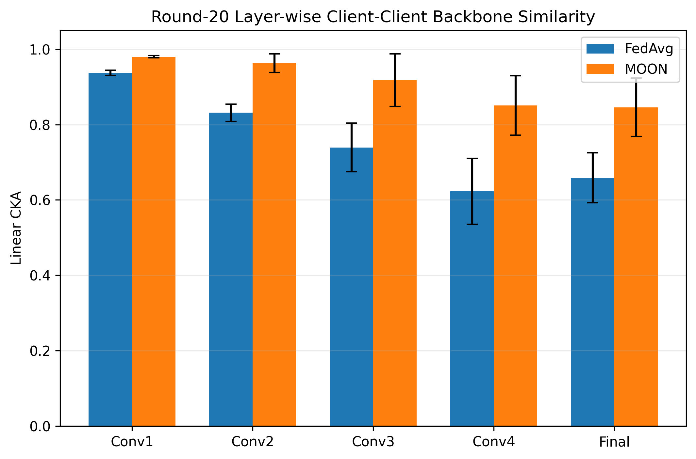

# Backbone Consistency in Federated Learning on PTB-XL ECGs

**Does a representation-consistency objective (MOON-style) keep the CNN backbones of different hospitals aligned under strong Non-IID data — and does that translate into better predictions?**

Master's research project.

## Overview

| | |
|---|---|
| Dataset | [PTB-XL v1.0.3](https://physionet.org/content/ptb-xl/1.0.3/) (12-lead ECG, multi-label) |
| Task | 5 diagnostic superclasses: NORM, MI, STTC, CD, HYP |
| Federated setup | 5 simulated hospitals, strong patient-level Non-IID split, no patient leakage |
| Model | 1D CNN (Conv1–Conv4 + 256-d pooled representation, GroupNorm) |
| Methods | Centralized · FedAvg · MOON-style |
| Training | 20 rounds, 2 local epochs, Adam (lr 1e-3), effective batch 32, MOON μ=1.0, τ=0.5 |
| Seeds | 42, 123, 2026 (matched across methods) |
| Split | Train: folds 1–8 · Validation: fold 9 · Test: fold 10 |
| Representation analysis | Linear CKA on a fixed 500-ECG subset of fold 9, rounds 1/2/5/10/15/20, Client–Client and Local–Global |

> "MOON-style": the contrastive consistency loss is applied directly to the 256-d pooled backbone representation, without a projection head.

## Key results (mean ± std, 3 seeds, fold 10)

| Method | BCE loss ↓ | Macro-F1 ↑ | Macro-AUROC ↑ | Exact match ↑ |
|---|---|---|---|---|
| Centralized | 0.382 ± 0.011 | 0.702 ± 0.006 | 0.913 ± 0.001 | 0.597 ± 0.005 |
| FedAvg | 0.503 ± 0.044 | 0.442 ± 0.038 | 0.849 ± 0.006 | 0.482 ± 0.007 |
| MOON-style | 0.437 ± 0.011 | 0.468 ± 0.046 | 0.858 ± 0.007 | 0.481 ± 0.007 |

**Round-20 Client–Client CKA gain (MOON-style − FedAvg):**
Conv1 +0.043 · Conv2 +0.132 · Conv3 +0.178 · Conv4 +0.228 · Final representation +0.188

**Take-away:** the effect on representation similarity is much larger than the effect on predictive performance, and it grows with depth. CKA is used as a complementary analysis tool — it is *not* evidence of clinical robustness or causality. With 3 seeds, differences in macro-F1 are within one standard deviation.



## Repository structure

```
src/                 training, evaluation and figure scripts
data_protocol/       Non-IID hospital partition + the 500 validation ECGs used for CKA
results/             metrics, CKA tables, summaries (no checkpoints)
```

## Reproducing

```bash
pip install -r requirements.txt
```

1. **Get the data** from PhysioNet (PTB-XL v1.0.3) — it is not included here.
2. **Partition** (or reuse `data_protocol/ptbxl_noniid_N2_5_hospitals.csv`):
   ```bash
   PTBXL_ROOT=/path/to/ptb-xl python src/step6_5_1_create_N2_partition.py
   ```
3. **Train.** The training scripts resolve paths relative to their own location (`ROOT = Path(__file__).parent`). Copy the `src/*.py` scripts into the PTB-XL folder (the one containing `records100/`, `ptbxl_database.csv`, `scp_statements.csv`) and put the partition CSV in `step6_5_1_N2_partition/`. Then:
   ```bash
   python step6_13_N2_FedAvg_seed42_matched.py   # also seed123 / seed2026
   python step6_13_N2_MOON_seed42_matched.py     # also seed123 / seed2026
   python step6_16_centralized_3seeds_matched.py
   ```
   Runs are crash-safe (resume state) and memory-safe (gradient accumulation, micro-batch 4).
4. **Evaluate + CKA, then figures:**
   ```bash
   python step6_14_multiseed_evaluation_CKA.py
   python step6_15_final_figures.py
   ```

## Citation

If you use this work, please cite the PTB-XL dataset (Wagner et al., 2020).

## License

Code: MIT. PTB-XL is distributed by PhysioNet under its own license (CC BY 4.0).
